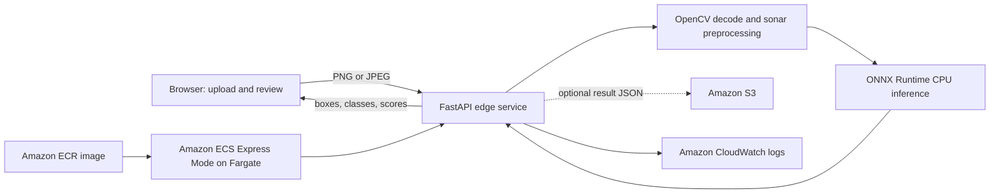

# DRISHTI — Side-Scan Sonar Hazard Detection

**OpenCV AI Competition 2026, powered by AWS**

DRISHTI is a sonar-imaging project that uses computer vision to identify candidate seabed hazards in side-scan sonar (SSS) imagery. The repository contains a full local survey-review workflow and a smaller CPU edge-inference app. The edge app is the version deployed for the contest demo.

| Try it | Link |
|---|---|
| Live edge demo | [Open DRISHTI on AWS](https://dr-b3baa1d3c12848cdb860091b09a68618.ecs.us-east-1.on.aws) |
| Edge API docs | [Interactive API reference](https://dr-b3baa1d3c12848cdb860091b09a68618.ecs.us-east-1.on.aws/docs) |
| Source code | [GitHub repository](https://github.com/Rehan9599/opencv-ai-competition-Sonar-project) |
| Public dataset | [DRISHTI SSS on Hugging Face](https://huggingface.co/datasets/rehan9599/drishti-sss) |
| Model artifacts | [DRISHTI detector on Hugging Face](https://huggingface.co/rehan9599/drishti-detector) |

## Project overview

The detector identifies four product classes: submarine pipelines, shipwrecks, ghost nets, and mine cylinders. The system is designed to help an analyst prioritize sonar review; predictions are candidate detections and require human verification.

### Two ways to use DRISHTI

**Edge demo (deployed and runnable locally).** A FastAPI service loads the FP32 ONNX model, applies OpenCV preprocessing, and returns boxes, labels, and model scores. A lightweight HTML interface in `edge/static/` lets a user upload one PNG or JPEG, view detections over the image, and inspect runtime details. The same-origin interface and API are packaged together in a Docker image. The edge flow does not geolocate a single uploaded tile.

**Full survey dashboard (local project workflow).** The React 18 + Vite + React-Leaflet dashboard in `apps/dashboard/` works with the Django REST/Channels API and the PostgreSQL, Redis, and Celery services. It supports multi-file jobs, WebSocket progress, geotagged map review when navigation data is available, analyst confirm/reject actions, and JSON/CSV/GeoJSON exports. This larger stack is separate from the public AWS edge demo and is not included in its container. Follow [docs/LOCAL_SETUP.txt](docs/LOCAL_SETUP.txt) for setup and known issues.

## Contest edge architecture



OpenCV is used for image decoding, grayscale conversion, Lee speckle filtering, CLAHE contrast enhancement, resizing, and preparing annotated output. ONNX Runtime performs neural-network inference on the CPU. The edge image includes the model artifact, so it does not download weights at runtime.

The AWS deployment uses Amazon ECR, Amazon ECS Express Mode on Fargate, Amazon S3 for optional result JSON, and Amazon CloudWatch for logs. Uploaded image bytes are handled by the inference request; when S3 result storage is enabled, the service saves the JSON result rather than the uploaded image.

## Run the edge demo locally

Requirements: Docker Desktop (or Docker Engine) and enough memory for the model container.

From the repository root:

```bash
docker build -f edge/Dockerfile.edge -t drishti-edge:local .
docker run --rm -p 8100:8100 drishti-edge:local
```

Open [http://localhost:8100](http://localhost:8100), choose a PNG or JPEG, and run detection. The local container has S3 result storage disabled unless `DRISHTI_S3_BUCKET` and AWS credentials are configured.

Useful edge endpoints:

| Method | Path | Purpose |
|---|---|---|
| `GET` | `/` | Browser upload and detection interface |
| `GET` | `/health` | Service, model, OpenCV, ONNX Runtime, and provider metadata |
| `POST` | `/detect` | Run inference for one uploaded image |
| `GET` | `/docs` | Interactive FastAPI documentation |

The demo accepts PNG/JPEG images up to 10 MB. It returns image-space boxes and model scores; there are no coordinates for a single tile.

## Run the full React dashboard locally

The dashboard requires the separate Django API, PostgreSQL, Redis, and Celery worker. From the repository root, the quick-start path is:

```bash
cp .env.example .env
docker compose up -d --build
docker compose exec web python manage.py migrate
docker compose exec web python manage.py createsuperuser
pnpm install
pnpm --filter @drishti/dashboard dev
```

The Vite dashboard is served at `http://localhost:5173`; the Django API is served at `http://localhost:8000`. On Windows PowerShell, use `Copy-Item .env.example .env` for the environment-file copy. See [docs/LOCAL_SETUP.txt](docs/LOCAL_SETUP.txt) for prerequisites, complete commands, troubleshooting, and known issues. The full Compose stack was not smoke-tested as part of the current edge deployment verification.

## Model and data

- **Detector:** YOLOv8s fine-tuned for sonar box detection and exported as FP32 ONNX for edge inference.
- **Preprocessing:** grayscale conversion, Lee MMSE despeckle filtering with a 7×7 kernel, and CLAHE (clip limit 3.0, 8×8 grid); the configured input size is 640×640.
- **Public dataset:** 5,205 tiles at pinned revision [`627849579f6dcee0897a112c6796736eb7900032`](https://huggingface.co/datasets/rehan9599/drishti-sss/tree/627849579f6dcee0897a112c6796736eb7900032): 3,875 train, 630 validation, and 700 test tiles.
- **Product taxonomy:** `submarine_pipeline`, `shipwreck`, `ghost_net`, and `mine_cylinder`. The detector has an additional `crab_pot` output ID that is filtered from the product; that class has no labels in the published dataset.
- **Dataset license:** CC-BY-SA-4.0. See the [dataset card](docs/hf/dataset_card.md) and its upstream source attributions before reusing the data.
- **Model details:** See [docs/hf/model_card.md](docs/hf/model_card.md). The model file and exact SHA-256 used for evaluation are listed in [docs/evaluation_manifest.yaml](docs/evaluation_manifest.yaml).

## Evaluation

The following diagnostic evaluates raw ONNX outputs on all 700 tiles in the pinned public test split. Matching is greedy, one-to-one, per image and class, with confidence threshold `0.25` and IoU threshold `0.50`. The detector's per-class gates and calibration are not applied. These are fixed-threshold precision/recall results, **not mAP**.

| Class | TP | FP | FN | Precision | Recall |
|---|---:|---:|---:|---:|---:|
| Submarine pipeline | 168 | 6 | 6 | 96.6% | 96.6% |
| Shipwreck | 180 | 100 | 345 | 64.3% | 34.3% |
| Ghost net | 120 | 0 | 0 | 100.0% | 100.0% |
| Mine cylinder | 38 | 26 | 44 | 59.4% | 46.3% |

The ghost-net examples are synthetic-on-synthetic and do not establish performance on real ghost nets. Shipwreck site-disjointness has not been fully audited. An observed evaluation time of 134.7 ms per test tile included image decode, inference, and matching; the host hardware was not recorded, so this is not a hardware-independent latency benchmark. Earlier 850-tile, mAP, and calibration claims could not be reproduced from the pinned 700-tile test split and are not reported as verified results. Full method and limitations are recorded in [docs/evaluation_manifest.yaml](docs/evaluation_manifest.yaml).

## AWS deployment

The current public service is deployed in `us-east-1` on ECS Express Mode with one Fargate task (1 vCPU, 2 GB). Its current ECR image is `drishti-9599:contest-ui-v2` (`sha256:a5642b9ae1406f11d2921c875859c6112700bdb410acf3a68754b43a54519383`). ECR holds the container image, S3 stores optional result JSON under `drishti/results/`, and CloudWatch stores logs. The service is limited to one task and accepts unauthenticated uploads, so use it as a demonstration endpoint.

To publish an updated edge UI or API from PowerShell at the repository root, use a new image tag and the AWS profile configured for this account:

```powershell
$Region = "us-east-1"
$AccountId = "563691829406"
$Repo = "drishti-9599"
$Tag = "contest-ui-v2"
$Registry = "$AccountId.dkr.ecr.$Region.amazonaws.com"

aws ecr get-login-password --region $Region --profile drishti-contest |
  docker login --username AWS --password-stdin $Registry
docker build -f edge/Dockerfile.edge -t "drishti-edge:$Tag" .
docker tag "drishti-edge:$Tag" "${Registry}/${Repo}:${Tag}"
docker push "${Registry}/${Repo}:${Tag}"
```

After the push, update the `drishti-edge` ECS Express Mode service to use the new ECR tag or image digest and deploy the new revision. ECS keeps running the image digest from its existing deployment until the service is updated. When deployment reports healthy, refresh the [live demo](https://dr-b3baa1d3c12848cdb860091b09a68618.ecs.us-east-1.on.aws) and verify `/health`.

For the full account setup and service configuration, see [deploy/aws/README.md](deploy/aws/README.md) and [docs/AWS_DEPLOYMENT_PLAN.md](docs/AWS_DEPLOYMENT_PLAN.md). A monthly AWS Budget alert is not currently configured.

## Full-stack API overview

These routes belong to the local Django dashboard workflow, not the deployed edge API. The full contract is in [docs/API_ENDPOINTS.md](docs/API_ENDPOINTS.md).

| Method | Path | Purpose |
|---|---|---|
| `POST` | `/api/upload/` | Submit sonar image(s), optionally with navigation files, and create a job |
| `GET` | `/api/jobs/` and `/api/jobs/<id>/` | List jobs or inspect job status/progress |
| `GET` | `/api/detections/<job_id>/` | Retrieve detections for a job |
| `PATCH` | `/api/detections/<id>/review/` | Confirm or reject a candidate and record an audit entry |
| `GET` | `/api/detections/<id>/image/` | View a source-tile crop with its box |
| `GET` | `/api/export/<job_id>/?format=json\|csv\|geojson` | Download a job report |
| `WS` | `/ws/jobs/<job_id>/` | Receive per-tile and job-completion events |

## Repository map

```text
apps/api/          Django REST, Channels, Celery, and job processing
apps/dashboard/    React/Vite/React-Leaflet analyst dashboard
edge/              FastAPI ONNX edge service, upload UI, and Dockerfile
ml/inference/      Detection, preprocessing, confidence, and pipeline modules
ml/geotagging/     Navigation parsing and coordinate projection
ml/reporting/      JSON, CSV, and report schemas
ml/models/exported/ ONNX model and calibration artifact
notebooks/         Colab quickstart
demo/              Curated sample tiles and demo materials
docs/              Competition, setup, evaluation, model, and deployment documentation
```

Training datasets and large checkpoint backups are not stored in Git. Download instructions and the data/model licenses are maintained in the Hugging Face cards linked above.

## Limitations and responsible use

- Detections are candidates for analyst review, not confirmed findings or enforcement evidence.
- Recall differs by class; the current shipwreck and mine-cylinder evaluation shows substantial missed detections.
- The ghost-net evaluation is synthetic-only, and generalization across independent survey sites and sonar systems is not established.
- Calibration and mAP metrics need to be recomputed on the pinned public test split before making claims about them.
- Edge single-image inference does not geolocate a tile. Coordinates in the larger local workflow depend on survey navigation data and should be interpreted as search areas.
- The public edge endpoint has no authentication, has a 10 MB upload limit, and is capped at one task.

## Competition and project documentation

- [Competition architecture and submission notes](docs/OPENCV_AI_COMPETITION_2026.md)
- [Current project status](docs/PROJECT_STATUS.md)
- [Evaluation manifest and reproducibility record](docs/evaluation_manifest.yaml)
- [Local stack setup and troubleshooting](docs/LOCAL_SETUP.txt)
- [AWS deployment runbook](deploy/aws/README.md)
- [AWS deployment plan](docs/AWS_DEPLOYMENT_PLAN.md)
- [REST and WebSocket API contract](docs/API_ENDPOINTS.md)
- [Dataset card](docs/hf/dataset_card.md) · [Model card](docs/hf/model_card.md)
- [Technical document inventory](docs/Documents/README.md) · [PDF audit](docs/PDF_AUDIT.md)
