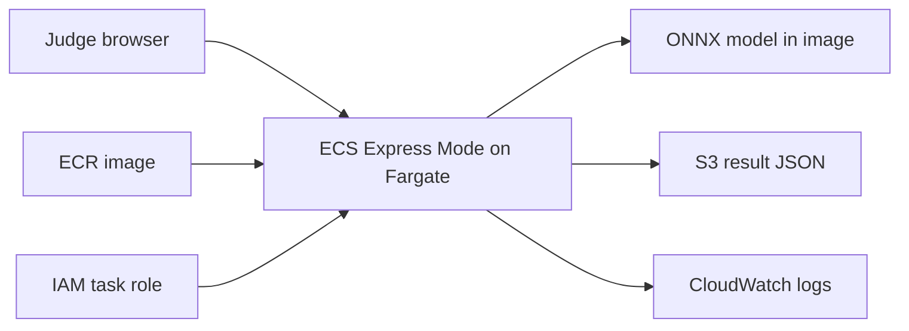

# DRISHTI AWS Deployment Plan

## Goal

Deploy the lightweight `edge/` inference API for the OpenCV AI Competition. Keep the Django,
PostgreSQL, Redis, Celery, and dashboard stack for local demonstration unless the live demo
proves it is required.

## Target architecture



Recommended deployment: **ECR + Amazon ECS Express Mode + S3**. App Runner is closed to new
customers; ECS Express Mode creates the Fargate service, HTTPS load balancer, health checks,
autoscaling, and monitoring from the ECR image.

## Current deployment snapshot — 2026-10-25

- Region: `us-east-1`
- ECR image: `563691829406.dkr.ecr.us-east-1.amazonaws.com/drishti-9599:contest-frontend-1`
- Image digest: `sha256:fb7722bf38d41737f6ce86e423cf60d238e9f1bd433648cd704392e8f4306f6b`
- S3 results bucket: `drishti95-bucket`; `drishti/results/` expires after 30 days
- ECS Express Mode service: `drishti-edge`, 1 vCPU, 2 GB, one-task maximum
- Public URL: `https://dr-b3baa1d3c12848cdb860091b09a68618.ecs.us-east-1.on.aws`
- CloudWatch logs: `/aws/ecs/default/drishti-edge-ab52`, 14-day retention
- `/health`, `/detect`, and S3 result writes were verified. ECS deployment completed.
- The edge upload UI is served at `/`; the full React/Django dashboard is not part of this edge service.
- No monthly AWS Budget alert is configured yet.

## Phase 1: local readiness

Acceptance criteria:

- `python -m compileall edge ml/scripts scripts` passes.
- `docker build --check -f edge/Dockerfile.edge .` passes.
- Full `docker build` succeeds on a network that can reach Debian mirrors.
- The container returns `200` from `/health`.
- `/health` reports OpenCV, NumPy, ONNX Runtime, provider, model name, model SHA-256, and the
  four shipped classes.
- `/detect` rejects oversized or undecodable uploads.
- S3 storage is disabled when `DRISHTI_S3_BUCKET` is empty.

## Phase 2: AWS resources

Create:

1. A private ECR repository; this account uses `drishti-9599`.
2. A private S3 bucket with public access blocked and default encryption enabled; this account uses `drishti95-bucket`.
3. A lifecycle rule deleting contest result objects after 30 days.
4. A CloudWatch log group with a defined retention period.
5. An ECS task execution role, ECS Express Mode infrastructure role, and a least-privilege task role for S3 writes. The active account required the supplemental tag-scoped ALB-create and read-only VPC-discovery policies in `deploy/aws/iam/`.
6. An AWS Budget alert for the contest account or project.

The S3 role should have only:

```json
{
  "Effect": "Allow",
  "Action": ["s3:PutObject"],
  "Resource": "arn:aws:s3:::<bucket>/drishti/results/*"
}
```

Do not commit access keys. Use an IAM role, OIDC, or the AWS CLI credential chain.

## Phase 3: image publication

```bash
export AWS_REGION=us-east-1
export AWS_ACCOUNT_ID=563691829406
export ECR_REPOSITORY=drishti-9599
export IMAGE_TAG=contest-frontend-1

aws ecr create-repository \
  --repository-name "$ECR_REPOSITORY" \
  --region "$AWS_REGION"

aws ecr get-login-password --region "$AWS_REGION" |
  docker login --username AWS --password-stdin \
  "$AWS_ACCOUNT_ID.dkr.ecr.$AWS_REGION.amazonaws.com"

docker build -f edge/Dockerfile.edge -t drishti-edge:frontend-1 .
docker tag drishti-edge:frontend-1 \
  "$AWS_ACCOUNT_ID.dkr.ecr.$AWS_REGION.amazonaws.com/$ECR_REPOSITORY:$IMAGE_TAG"
docker push \
  "$AWS_ACCOUNT_ID.dkr.ecr.$AWS_REGION.amazonaws.com/$ECR_REPOSITORY:$IMAGE_TAG"
```

## Phase 4: ECS Express Mode service configuration

Set these environment variables in the ECS Express Mode service:

```text
DRISHTI_ONNX=/app/ml/models/exported/best_detector.onnx
DRISHTI_CALIBRATOR=/app/ml/models/exported/calibrator.pkl
DRISHTI_PREPROCESS=1
DRISHTI_MAX_UPLOAD_BYTES=10485760
DRISHTI_S3_BUCKET=<private-bucket>
DRISHTI_S3_PREFIX=drishti/results
AWS_REGION=<region>
```

Configure the container port as `8100`, and the HTTP health check path as:

```text
GET /health
```

Start with one task at 1 vCPU and 2 GB memory, with the maximum task count set to one for the
demo. The ONNX model is bundled in the image, so no runtime model download is needed. Attach
the S3 write policy to the **task role**; keep ECR pull and log permissions on the separate
**task execution role**.

## Phase 5: production smoke test

```bash
export SERVICE_URL=https://<service-hostname>
curl --fail "$SERVICE_URL/health"
curl --fail \
  -F "file=@demo/frontend_test/02_shipwreck.jpg" \
  "$SERVICE_URL/detect"
```

Repeat with pipeline, mine, ghost-net, empty-seabed, and invalid-file samples. Record:

- HTTP status and latency
- Detection count and JSON response
- `result_uri` returned by S3 storage
- CloudWatch log event
- OpenCV and model hash from `/health`

## Go/no-go gates

**Go** only when:

- The service is reachable from a judge browser.
- S3 writes succeed with the restricted IAM role.
- The container health check remains green after restart.
- No credentials appear in the image, logs, or repository.
- Metrics and limitations match `docs/evaluation_manifest.yaml`.

If deployment is not stable, use the local container plus a live screen-share fallback. Do not
publish an unverified endpoint or claim field performance for synthetic ghost-net results.
