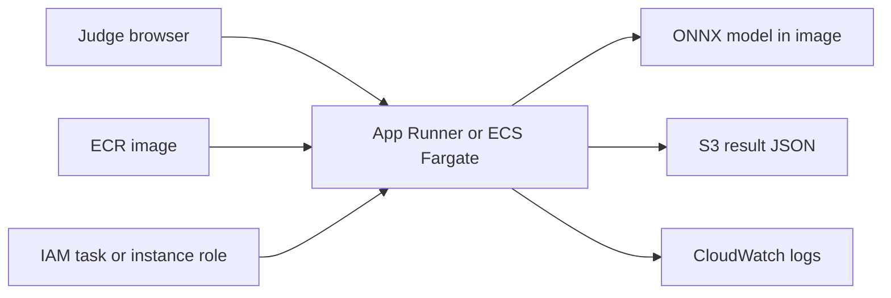

# DRISHTI AWS Deployment Plan

## Goal

Deploy the lightweight `edge/` inference API for the OpenCV AI Competition. Keep the Django,
PostgreSQL, Redis, Celery, and dashboard stack for local demonstration unless the live demo
proves it is required.

## Target architecture



Recommended first deployment: **ECR + App Runner + S3**. Use ECS Fargate if App Runner cannot
provide the required networking, health-check, or observability controls.

## Phase 1: local readiness

Acceptance criteria:

- `python -m compileall edge ml/scripts scripts` passes.
- `docker build --check -f edge/Dockerfile.edge .` passes.
- Full `docker build` succeeds on a network that can reach Debian mirrors.
- The container returns `200` from `/health`.
- `/health` reports OpenCV, NumPy, ONNX Runtime, provider, model name, model SHA-256, and the
  four shipped classes.
- `/detect` rejects oversized or undecodable uploads.
- S3 storage is disabled when `DRISHTI_S3_BUCKET` is empty.

## Phase 2: AWS resources

Create:

1. An ECR repository named `drishti-edge`.
2. A private S3 bucket with public access blocked and default encryption enabled.
3. A lifecycle rule deleting contest result objects after 30 days.
4. A CloudWatch log group with a defined retention period.
5. An App Runner instance role or ECS task role.
6. An AWS Budget alert for the contest account or project.

The S3 role should have only:

```json
{
  "Effect": "Allow",
  "Action": ["s3:PutObject"],
  "Resource": "arn:aws:s3:::<bucket>/drishti/results/*"
}
```

Do not commit access keys. Use an IAM role, OIDC, or the AWS CLI credential chain.

## Phase 3: image publication

```bash
export AWS_REGION=us-east-1
export AWS_ACCOUNT_ID=000000000000
export ECR_REPOSITORY=drishti-edge
export IMAGE_TAG=contest-2026

aws ecr create-repository \
  --repository-name "$ECR_REPOSITORY" \
  --region "$AWS_REGION"

aws ecr get-login-password --region "$AWS_REGION" |
  docker login --username AWS --password-stdin \
  "$AWS_ACCOUNT_ID.dkr.ecr.$AWS_REGION.amazonaws.com"

docker build -f edge/Dockerfile.edge -t "$ECR_REPOSITORY:$IMAGE_TAG" .
docker tag "$ECR_REPOSITORY:$IMAGE_TAG" \
  "$AWS_ACCOUNT_ID.dkr.ecr.$AWS_REGION.amazonaws.com/$ECR_REPOSITORY:$IMAGE_TAG"
docker push \
  "$AWS_ACCOUNT_ID.dkr.ecr.$AWS_REGION.amazonaws.com/$ECR_REPOSITORY:$IMAGE_TAG"
```

## Phase 4: service configuration

Set these environment variables in App Runner or the ECS task definition:

```text
DRISHTI_ONNX=/app/ml/models/exported/best_detector.onnx
DRISHTI_CALIBRATOR=/app/ml/models/exported/calibrator.pkl
DRISHTI_PREPROCESS=1
DRISHTI_MAX_UPLOAD_BYTES=10485760
DRISHTI_S3_BUCKET=<private-bucket>
DRISHTI_S3_PREFIX=drishti/results
AWS_REGION=<region>
```

Expose port `8100`. Configure the service health check as:

```text
GET /health
```

Set a CPU-only instance size first. The ONNX model is already bundled in the image, so no
runtime model download is needed.

## Phase 5: production smoke test

```bash
export SERVICE_URL=https://<service-hostname>
curl --fail "$SERVICE_URL/health"
curl --fail \
  -F "file=@demo/frontend_test/02_shipwreck.jpg" \
  "$SERVICE_URL/detect"
```

Repeat with pipeline, mine, ghost-net, empty-seabed, and invalid-file samples. Record:

- HTTP status and latency
- Detection count and JSON response
- `result_uri` returned by S3 storage
- CloudWatch log event
- OpenCV and model hash from `/health`

## Go/no-go gates

**Go** only when:

- The service is reachable from a judge browser.
- S3 writes succeed with the restricted IAM role.
- The container health check remains green after restart.
- No credentials appear in the image, logs, or repository.
- Metrics and limitations match `docs/evaluation_manifest.yaml`.

If deployment is not stable, use the local container plus a live screen-share fallback. Do not
publish an unverified endpoint or claim field performance for synthetic ghost-net results.
